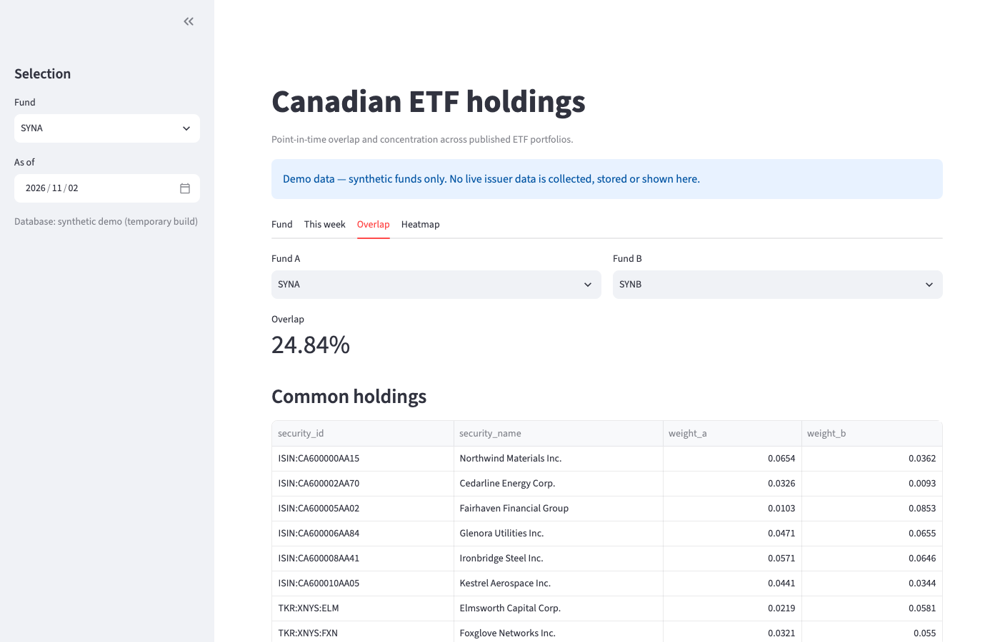
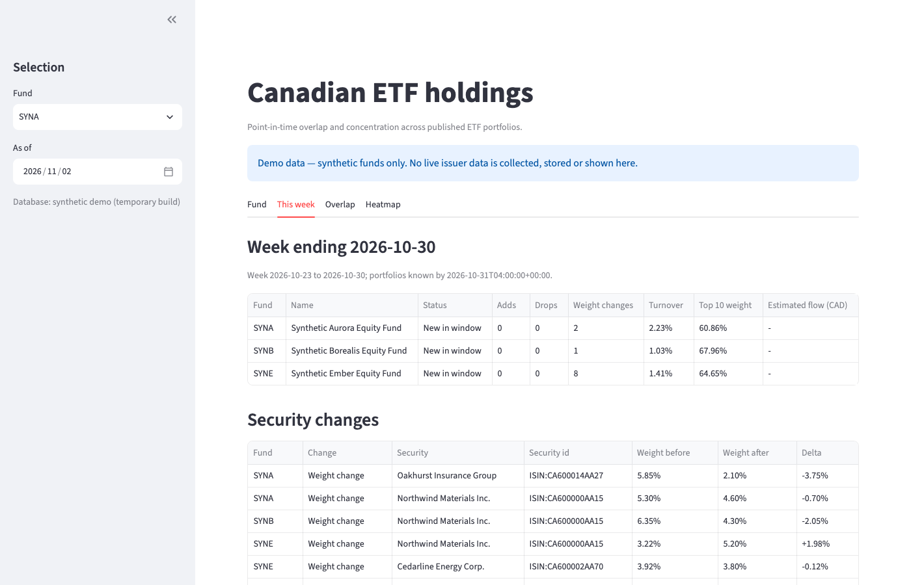

# cad-etf-holdings

cad-etf-holdings collects the portfolio holdings Canadian ETF issuers publish, normalizes them into one point-in-time dataset, and answers questions like "how much do these two funds overlap?" and "which ETFs added this stock last quarter?". Collection is deliberately polite: every source has a recorded terms-of-use decision, and nothing is fetched or redistributed without one.



Status: **Phase 1 is ready to ship.** Phase 2 (flows, disclosure history, scheduled collection) and Phase 3 (weekly digest, event study) are code complete. Scheduled collection and the published site ship disabled until repository variables switch them on after the release (D76); the Streamlit deployment and the `v1.0.0` tag are the two remaining ship steps.

## What it does

- **Collects what issuers publish.** Daily holdings files (CSV, XLSX, JSON) and quarterly portfolio disclosure PDFs, stored unmodified with URL, fetch time and SHA-256 so every number can be traced back to its file.
- **Normalizes it into one table.** Weights as fractions, exchanges as ISO 10383 MICs, asset classes, and a security master that uses a provided ISIN/CUSIP first, then an exchange-qualified ticker, then a human-reviewed name override — never a silent merge.
- **Keeps it point-in-time.** Every distinct file content is a version with a `known_at` timestamp; analytics for a date use only files known by then, and a republished file becomes a new version instead of overwriting the old one.
- **Detects changes.** Adds, drops and weight changes between consecutive portfolio dates, per fund.
- **Measures overlap and concentration.** Pairwise overlap (`Σ min(wᵢ, wⱼ)`), top-10 weight, Herfindahl index, holding counts and sector/country breakdowns, shown in a Streamlit dashboard and available through the CLI and derived-aggregate exports.
- **Estimates flows and recovers history.** Daily NAV per unit, shares outstanding and AUM become creation/redemption flow estimates, and historical quarterly disclosures extend the holdings panel backwards.
- **Publishes a weekly digest.** Adds, drops, weight changes, turnover, top-10 weight and overlap shifts for each fund, as a static site with an Atom feed, built from a validated JSON document.
- **Measures what large additions do to prices.** An exploratory event study of abnormal returns around large portfolio additions, with the security-level table kept internal.

## Weekly digest

`etfh weekly` builds one digest document per week end from the built database, validates it and renders a static site (index, one page per week, JSON, Atom feed, `.nojekyll`). The week runs Friday to Friday; the default is the most recent Friday.

```bash
uv run etfh build --raw tests/fixtures/raw_synthetic --out /tmp/etfh
uv run etfh weekly --db /tmp/etfh/etfh.duckdb --out /tmp/etfh-site --week-end 2026-11-03
uv run etfh weekly --demo --out /tmp/etfh-demo-site      # synthetic store, no database needed
```

- **Empty weeks are dropped, not published.** A week whose funds have no comparable portfolio is printed (`skipped week ending …`) and left out; only a run where no requested week has any holding exits 1. `--weeks N` publishes the newest N week ends, and a later run with fewer weeks removes the older pages it no longer covers.
- **`--public` is the default; `--internal` is not for publication.** The public document shows security names, identifiers and weights only for synthetic funds or for sources whose terms record `redistribution_allowed: true` (none of the real sources do today, D79); everything else carries counts, turnover, concentration and overlap only. `--internal` includes security lines for every fund and prints a warning.
- **`--demo`** builds the committed synthetic store in a temporary directory, ignores `--db`, marks every document `"demo": true` and takes the week end from the synthetic data instead of the clock. Every page then shows "Demo data — synthetic funds only".
- **The site is small and self-contained.** No JavaScript, no external requests, light and dark themes, every page labels itself "Derived data · exploratory · not investment advice". An `archive.html` lists every published week; the renderer accepts a base URL for canonical links and Atom ids.
- **Scheduling is opt-in.** `.github/workflows/pages.yml` runs every Saturday and publishes the site only when the repository variable `ETFH_PAGES` is `true`; `ETFH_PAGES_REAL=true` switches it from the synthetic demo to real aggregates and additionally needs the private data checkout and the human's go-ahead (D79). Both are unset today.
- **The dashboard has four tabs: Fund, This week, Overlap and Heatmap.** The "This week" tab shows the same digest for the selected date; the hosted demo builds the public document and the local dashboard an internal one.



## Event study (exploratory)

A large addition is a security that was absent from the previous known portfolio and appears with weight ≥ 1 %, or an existing position that gains ≥ 0.5 percentage points. `etfh event-study` measures abnormal returns around those events: day 0 is the first trading day on or after the date the file first became known, returns come from split- and dividend-adjusted closes, `market_adjusted` subtracts the benchmark return (SPY by default) and `market_model` estimates α/β over `[-120, -11]`. CARs are reported for `[-1,1]`, `[0,1]`, `[0,5]` and `[-5,5]` with a cross-sectional t-statistic and a percentile bootstrap 95 % interval.

```bash
uv run etfh build --raw tests/fixtures/raw_synthetic --out /tmp/etfh
uv run etfh event-study --db /tmp/etfh/etfh.duckdb --raw tests/fixtures/raw_synthetic \
  --out /tmp/etfh-event-study --source synthetic
```

- **`--source synthetic` is offline and clearly labelled.** It uses a deterministic simulated price series and resolves the security's own ticker on any venue, because the committed fixtures are TSX-listed; the numbers it prints are simulated. A real run uses `--source tiingo` and needs `TIINGO_API_KEY`; `etfh prices fetch --symbols A,B --from D --to D --raw DIR` warms the same cache separately, refusing a source whose terms do not allow it and refusing to exceed the free-plan request budget.
- **Every skipped event is counted**, never silently dropped: `no_symbol`, `no_prices`, `short_estimation`, `window_incomplete`, `duplicate`. Outputs are `summary.json` and `car_by_day.csv` (aggregates only, safe to publish) plus `per_event.internal.csv` (security-level, internal only).
- **This is exploratory research, not a strategy.** It has no additional controls (size, sector, event clustering) and the results are labelled "exploratory" in the summary and every printed line.

## Responsible collection

- **Terms gate.** Every source has a recorded terms-of-use decision in `config/sources.yaml`. A source that is not `allowed` or `allowed_with_conditions` is refused in code — both when `collect` picks collectors and again on every HTTP request. The synthetic sources never make a request.
- **Polite requests.** At most one request per second per host, slower when robots.txt `Crawl-delay` or the source's recorded conditions say so. robots.txt is honoured per RFC 9309, retries use exponential backoff with jitter, and `Retry-After` is respected up to a cap.
- **Identifiable client.** The User-Agent comes from `ETFH_USER_AGENT` and carries a contact address; it is never spoofed. No logins, no paywalls, no headless browsers. A source that needs JavaScript or blocks the client is marked unsupported instead of worked around.
- **Nothing raw is redistributed.** Downloads and the normalized holdings of real funds stay outside git. The public tree holds code, synthetic fixtures and derived aggregates (overlap, concentration, counts) only, unless a source's terms record explicitly permits more.
- **Scheduled collection keeps raw data private.** The GitHub Actions collection workflow checks out a separate private repository (`broiisapro/cad-etf-holdings-data` by default) and pushes each day's raw files and sidecars there, then rebuilds and runs QA in the runner's temporary directory. The public repository, job logs, job summaries and uploaded artifacts never receive a raw file or a holdings row: summaries carry counts and QA checks, artifacts carry derived aggregates (D77). The workflow ships disabled and runs only when `ETFH_ACTIONS_COLLECT` is `true`.
- **Publication rule (D79).** Anything public — the Pages digest, the hosted demo, workflow artifacts — may show security-level lines only for synthetic funds or for sources whose terms allow redistribution. Real funds appear as aggregates: counts of adds and drops, turnover share, overlap values and shifts, concentration and flow estimates. Publishing real aggregates on Pages still needs the maintainer's explicit go-ahead when it is enabled.

## Quick start (synthetic data)

Everything below runs offline against the committed fixtures in `tests/fixtures/`.

```bash
uv sync --frozen
uv run ruff check . && uv run mypy etfh
uv run pytest -q                                                    # offline suite
uv run etfh build --raw tests/fixtures/raw_synthetic --out /tmp/etfh
uv run etfh qa --db /tmp/etfh/etfh.duckdb                           # exit 0; the injected bad files are reported
uv run etfh overlap SYNA SYNB --asof 2026-11-02 --db /tmp/etfh/etfh.duckdb   # 0.2484
uv run etfh changes --fund SYNA --from 2026-10-29 --to 2026-11-02 --db /tmp/etfh/etfh.duckdb
uv run etfh spotcheck --raw tests/fixtures/raw_synthetic --db /tmp/etfh/etfh.duckdb --n 5
uv run etfh export --db /tmp/etfh/etfh.duckdb --out /tmp/etfh-export --asof 2026-11-02
uv run etfh verify-raw --raw tests/fixtures/raw_synthetic           # 15 files, no problems
uv run etfh sync-raw --from tests/fixtures/raw_synthetic --to /tmp/etfh-raw-copy
```

The overlap value matches `tests/fixtures/expected_overlap.json`. `etfh build` is a full rebuild, not an incremental update: the same raw store produces byte-identical Parquet. `etfh spotcheck` re-reads the latest included file per issuer and prints sampled raw values next to the normalized weights, so a parsing bug is visible against the file the numbers came from. `etfh export` writes derived aggregates only (`overlap_matrix.csv`, `concentration.csv`, `sector_breakdown.csv`) — never holdings rows, names or individual weights. `etfh verify-raw` recomputes every SHA-256 against its sidecar; `etfh sync-raw` copies only verified data-file/sidecar pairs and reports a conflict instead of overwriting a different file.

To preview the dashboard (the hosted demo runs on synthetic data; the local view reads a built database):

```bash
ETFH_DB=/tmp/etfh/etfh.duckdb uv run streamlit run etfh/dashboard/app.py
uv run streamlit run streamlit_app.py                               # demo mode, synthetic store at startup
```

## Running on real data

1. Copy `.env.example` to `.env` and set `ETFH_USER_AGENT` to a contact-bearing identifier (quote values containing spaces or parentheses). `OPENFIGI_API_KEY` is optional and only raises the OpenFIGI rate limit; `TIINGO_API_KEY` is needed only for price fetches.
2. Collect, build and check:

```bash
uv run etfh collect --date today --raw ./raw     # logs one line per fund/source; terms-refused sources print "skipped: terms"
uv run etfh collect-aum --date today --raw ./raw # daily NAV, shares outstanding and AUM (Phase 2)
uv run etfh verify-raw --raw ./raw               # every sidecar hash matches
uv run etfh build --raw ./raw --out ./build      # add --openfigi for cached composite FIGI ids
uv run etfh qa --db ./build/etfh.duckdb          # exit 0 only when every errored file is excluded and reported
```

3. Review the name proposals the build wrote next to the database:

```bash
uv run etfh review list --db ./build/etfh.duckdb --confidence exact
uv run etfh review approve --db ./build/etfh.duckdb --confidence exact \
  --reviewer "your name" --dry-run               # drop --dry-run to append the overrides
uv run etfh build --raw ./raw --out ./build      # overrides take effect on the next build
```

`etfh qa --max-unmatched-share X` turns the unmatched weight share into a gate and exits 3 when an included daily file exceeds it (quarterly top-holdings lists are not held to it). `ops/run_collect.sh` runs collect → collect-aum → build → qa in one pass (it loads `.env` itself), and `ops/install_launchd.sh` installs it behind a 30-minute daily guard: launchd polls every 30 minutes and at login, and the guard runs the pass at most once per local day after 18:00 (or immediately after a missed day), so a sleeping laptop still collects. The job's exit status is QA's status. The same pass runs on GitHub Actions (`ops/actions_collect.sh`) once `ETFH_ACTIONS_COLLECT` is enabled.

## Phase 2: estimated flows and disclosure history

```bash
uv run etfh collect-aum --date today --raw ./raw     # NAV, shares outstanding and AUM only
uv run etfh build --raw ./raw --out ./build          # writes the additive fund_metrics table
uv run etfh flows --fund ZSP --from 2026-10-01 --to 2026-10-23 --db ./build/etfh.duckdb
uv run etfh flows --fund PDF --from 2026-10-01 --to 2026-10-23 --db ./build/etfh.duckdb --json
uv run etfh backfill-qpd --issuer globalx_ca --quarters 8 --raw ./raw
```

- **Metrics.** `collect-aum` runs only `fund_metrics` sources, through the same terms gate as `collect`. BMO publishes net assets and shares outstanding on its ETF factsheet PDFs; Evolve states NAV and total net assets on its product pages (units are derived from the two and flagged); `purpose_metrics` has no collector and is derived from the `purpose_daily` files already in the raw store. Vanguard and Global X have no static, non-JavaScript metrics source and stay `supported: false` (D65).
- **Flow estimate (FR-2.1).** `etfh flows` prints `flow = (shares_t − shares_prev) × NAV_t`, where both figures come from the same fund and as-of date and `shares_prev` is the previous as-of date that has a share count — never a forward-filled value. A gap of more than one business day is flagged with `gap_days`. Every row, the table footer and the JSON carry the method label `Δshares × NAV (estimate; ignores distributions and in-kind effects)` (D67).
- **Backfill (FR-2.2).** `etfh backfill-qpd` walks the issuer's own disclosure listing for the last N calendar quarter-ends and reports every fund-quarter as `fetched`, `present` (already in the raw store) or `missing` with a reason; nothing is guessed and a missing quarter does not fail the command (D68).
- **As-of aware.** `fund_metrics` rows are versioned by SHA and `known_at` exactly like holdings, `etfh qa` has a "fund metrics" section, and `etfh qa --asof D` measures unmatched weight on the versions known by `D`.
- **Scheduled collection (FR-2.3).** `.github/workflows/collect.yml` runs on weekdays and ships disabled. It collects into the private data repository, verifies the store, pushes the day's files before rebuilding, writes a publish-safe QA summary to the job summary and uploads derived aggregates only. The launchd job stays the fallback until two scheduled runs are green (see `docs/epic-04-flows-and-history.md`).

## Architecture

One deterministic pipeline: collectors write every downloaded file unmodified into a raw store with a SHA-256 sidecar; per-issuer parsers declare their weight unit and produce the frozen holdings schema; validation and the security master turn that into the included `holdings` table plus `qa_events`; the build writes DuckDB and parquet, file versions, the additive `sources`, `fund_metrics` and changes tables; analytics reads only what was known by the requested date and feeds the CLI, the Streamlit dashboard and derived exports. The weekly digest compares two as-of snapshots per fund and renders the static site; the event study joins large-addition events to adjusted closes. The raw store is the source of truth and the build is always from scratch, so results are reproducible and auditable. The full design, package layout, workflows and decision records are in [`docs/architecture.md`](docs/architecture.md); per-epic detail is in [`docs/epic-00-foundation.md`](docs/epic-00-foundation.md), [`docs/epic-01-pipeline-core.md`](docs/epic-01-pipeline-core.md), [`docs/epic-02-real-data-integration.md`](docs/epic-02-real-data-integration.md), [`docs/epic-03-phase-1-ship.md`](docs/epic-03-phase-1-ship.md), [`docs/epic-04-flows-and-history.md`](docs/epic-04-flows-and-history.md) and [`docs/epic-06-publication.md`](docs/epic-06-publication.md).

## Data quality

- **Validation before anything is derived.** Pandera checks every parsed frame; file-level checks cover weight sums (with a tolerance that accounts for the printed unit and row count), duplicates, future as-of dates, unit contradictions, and quarterly disclosures against the total printed in the document. A file that fails gets no holdings rows but keeps a `file_versions` row and a `qa_events` entry, so it is visible rather than silently dropped.
- **A QA report with an exit code.** `etfh qa` reports every errored file, the daily and quarterly unmatched weight shares with per-issuer medians, and the worst funds. It exits 0 only when every errored file is excluded and reported, 1 when the tables are missing or an error is not accounted for, and 3 when `--max-unmatched-share` is exceeded. `--format markdown` prints the publish-safe version used in workflow summaries (counts and check names, no security lines).
- **Unmatched means unmatched.** A holding without identifier evidence stays unmatched and is reported (`reports/unmatched.csv`, `reports/name_proposals.csv`, `reports/fuzzy_proposals.csv`). Name-only rows are resolved only by a human-reviewed override that records the reviewer and review date; fuzzy proposals are suggestions, never applied automatically.
- **Traceable numbers.** `etfh spotcheck` prints raw file values next to normalized weights, every holdings row carries the SHA-256 of the file it came from, and `etfh verify-raw` proves the store still matches its sidecars.

## Limitations

- **Coverage follows permissions, not ambition.** Eight issuer sources are approved and the universe has 52 real funds plus 7 synthetic fixtures. Some issuer files are unsupported by design (bot challenge or JavaScript-only pages) and are never worked around.
- **Quarterly disclosures are top holdings only.** They are analysed as `partial` and labelled "top holdings only" in the dashboard; they never mix into a fund's daily series or into a weekly comparison.
- **Name-only issuers stay partly unmatched.** Exact name proposals have been reviewed and committed, but fuzzy matches require a human decision per name. Without `--openfigi`, issuer rows that carry only a Bloomberg country-composite code (Evolve) resolve through reviewed names, so their unmatched share is high; `--openfigi` expresses every mappable id as a composite FIGI and brings it close to zero.
- **OpenFIGI is optional and off by default.** Without `--openfigi`, ticker-only and ISIN issuers share fewer ids; with it, a cold cache needs network access.
- **Flows are estimates, not cash flows.** `(Δshares × NAV)` ignores distributions, in-kind creations and redemptions, and fee timing; every output carries that label (D67). Funds with a single metrics date have no previous share count yet, so no flow is printed for that date.
- **Metrics coverage follows static sources.** BMO factsheet PDFs and Evolve product pages are collected; Purpose metrics are derived from its daily files. Vanguard and Global X publish no static metrics source and stay unsupported. A BMO fund whose factsheet is not at the derived URL is reported as a collection error, not silently skipped.
- **Backfill follows what issuers still publish.** `backfill-qpd` only fetches disclosures an issuer still links (or a documented stable URL pattern); quarters that have disappeared from the listing are reported `missing`, never reconstructed.
- **A real event study resolves no symbols today.** Every large addition in the live store comes from BMO or Purpose rows identified by ISIN or name, and `etfh prices` maps only US-listed tickers. The event study therefore reports `no_symbol` for them; ticker resolution from the cached OpenFIGI mappings is the next step (D90). `--source synthetic` exists so the method can be exercised today.
- **Scheduled collection and the published site are off.** Nothing runs on a schedule in the public repository until `ETFH_ACTIONS_COLLECT` and `ETFH_PAGES` are set after the release; until then collection runs locally behind the launchd guard. `ETFH_PAGES_REAL` additionally needs the maintainer's explicit go-ahead (D79).
- **Real holdings are not distributed.** Only derived aggregates are shareable; there is no public dataset of individual fund holdings and the data repository is private.
- **Research software.** This is an engineering and data-quality project, not investment advice.

## Licence

MIT — see [`LICENSE`](LICENSE). Copyright (c) 2026 Moksh Siruvani.
